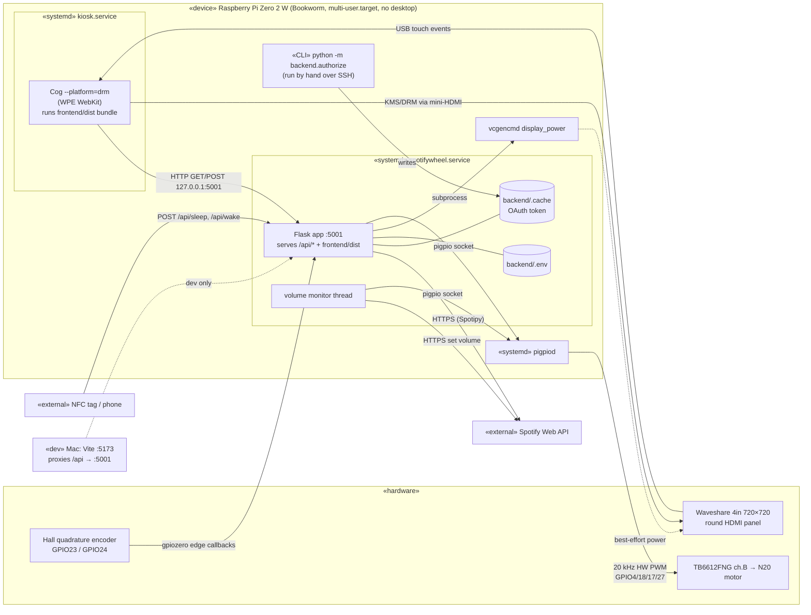
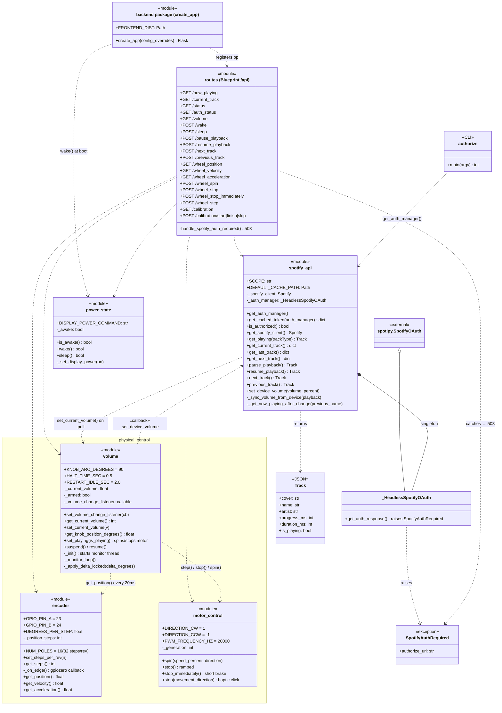
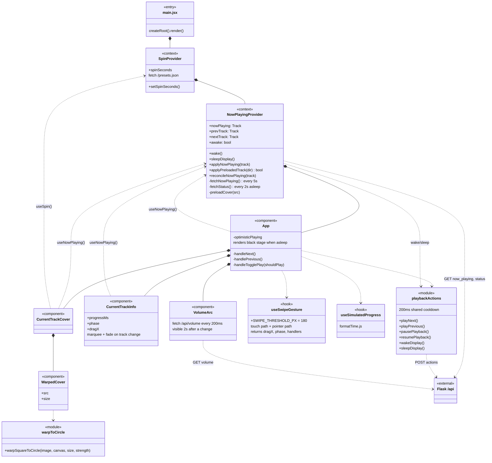
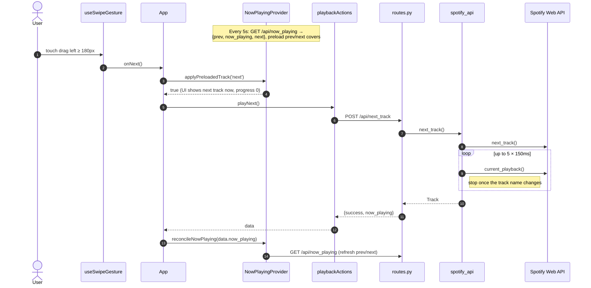
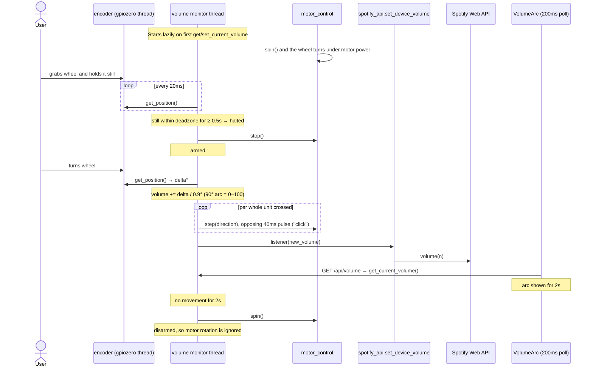

# Architecture

UML views of the current system, as Mermaid. They render on GitHub; in VS Code
they need a Mermaid-capable Markdown preview extension. The rationale behind the
design is in [`CLAUDE.md`](CLAUDE.md); this file just shows the structure.

1. [Deployment](#1-deployment): what runs where
2. [Backend modules](#2-backend-modules): the Python packages and how they depend on each other
3. [Frontend components](#3-frontend-components): the React tree, hooks and HTTP calls
4. [Sequence: swipe to next track](#4-sequence-swipe-to-next-track)
5. [Sequence: wheel as volume knob](#5-sequence-wheel-as-volume-knob)

## 1. Deployment

`kiosk.service` `Requires=` the backend and blocks in `ExecStartPre` until
`/api/status` answers. `spotifywheel.service` only `Wants=pigpiod`, because
the motor fails soft without it.

## 2. Backend modules

Every backend file is a module of functions plus module-level state, with no
instantiated classes. Each module is drawn as a `«module»` class: `-` marks
private state and helpers, `+` marks the public API. Dashed arrows are import
dependencies.

The `volume` ↔ `spotify_api` cycle is intentional. `volume` doesn't import
Spotify code. When `spotify_api` is imported, it registers `set_device_volume`
as a listener, and volume calls that from its monitor thread.

## 3. Frontend components

## 4. Sequence: swipe to next track

## 5. Sequence: wheel as volume knob

